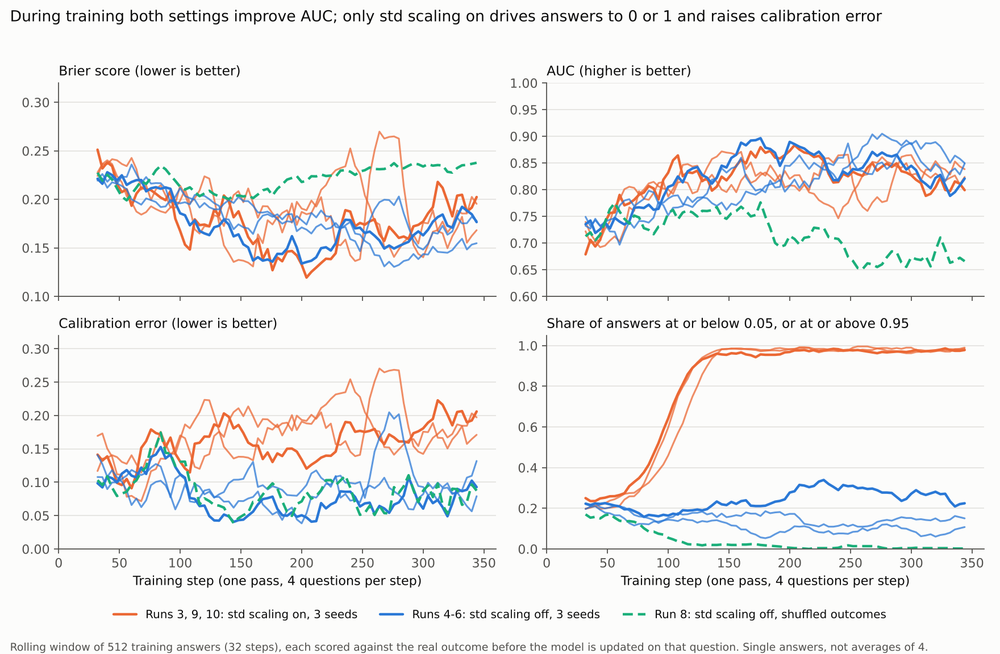
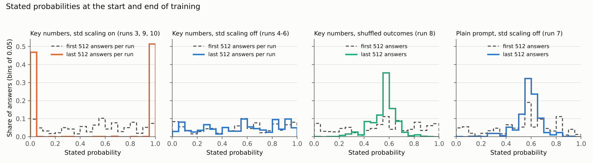

# Extra analyses: training diagnostics, gradient-boosted trees, skill scores, compute

Four analyses suggested in review. None needs new model runs; each uses the answers the runs already saved.

## 1. Training diagnostics

`analysis/training_diagnostics.py`. During training, each question is answered before the model is updated on it, so a rolling window of training answers scores the current model on questions it has not yet been rewarded on. It is still not a clean forward test: other questions from the same release (other thresholds, same outcome value) may already have been rewarded. So these curves can flatter the model, and the held-out results remain the evidence. Every run is scored against the real outcomes here, including run 8, whose rewards used shuffled ones.

| Key-numbers runs, single training answers | Brier | AUC | Calibration error | Near-certain answers |
| --- | --- | --- | --- | --- |
| Std scaling on (runs 3, 9, 10), first 512 answers | 0.224 to 0.251 | 0.68 to 0.74 | 0.12 to 0.17 | 20% to 25% |
| Std scaling on, last 512 answers | 0.183 to 0.210 | 0.80 to 0.83 | 0.19 to 0.21 | 98% to 99% |
| Std scaling off (runs 4-6), first 512 answers | 0.219 to 0.221 | 0.73 to 0.75 | 0.10 to 0.14 | 20% to 23% |
| Std scaling off, last 512 answers | 0.157 to 0.179 | 0.82 to 0.85 | 0.08 to 0.12 | 10% to 23% |
| Shuffled outcomes (run 8), first 512 answers | 0.227 | 0.71 | 0.10 | 17% |
| Shuffled outcomes, last 512 answers | 0.242 | 0.66 | 0.13 | 0.2% |

Ranges are across the three seeds. Each seed sees the training questions in a different order, so its first 512 answers are on different questions. "Near-certain" means at or below 0.05, or at or above 0.95. Every run, including the plain-prompt ones: `analysis/training_diagnostics_first_last.csv`; rolling values: `analysis/training_diagnostics_rolling.csv`.

- **In training, both settings learn to rank the questions.** AUC rises from about 0.72 to 0.80–0.85 with std scaling on or off.
- **The difference is what happens to the probabilities.**
  - With std scaling on, the share of near-certain answers climbs from about 20% to 98% between steps 75 and 140, and calibration error rises.
  - With it off, the share stays between about 10% and 35%, and calibration error stays where it was (0.08 to 0.12 at the end).
- **With shuffled outcomes, the model gets worse at the real task as training goes on.** AUC falls from 0.71 to 0.66, and the answers pile up around 0.55 (figure below).
- **Plain prompt:** run 7 (std off) hedges in the same way; the spread of its answers shrinks from 0.25 to 0.11. Run 1 (std on) moves less.
- **On held-out questions, the AUC gap between the settings opens up.** Std-off runs keep their gain (0.82 to 0.83), while std-on runs sit at the latest-result rule's 0.77 to 0.80 (`rl_runs9_10.md`).

The histograms show the endpoints of each pattern:

| Run | Start of training | End of training |
| --- | --- | --- |
| Std on | Spread out | Two spikes at 0 and 1 |
| Std off | Spread out | Still spread out |
| Shuffled outcomes and plain prompt with std off | Spread out | One peak around 0.55–0.6 |

`analysis/probability_histograms.csv`.

## 2. Gradient-boosted trees on the key numbers

`analysis/gbm_baseline.py` (scikit-learn 1.9.1). This is a stronger simple competitor than the logistic regression, given the same evidence the model's prompt contains.

**Versions** (scikit-learn's histogram gradient boosting, fitted on the training questions only):
- `gbm` uses the logistic regression's 5 features:
  - share of recent results that would have resolved YES;
  - whether the latest one would have;
  - distances of the latest result, the recent average and the last change from the threshold, scaled by the series' typical move.
- `gbm_series` adds the series as a categorical feature.

**How the settings were chosen:**
- A grid of 8 settings (tree depth 2 or 3, learning rate 0.03 or 0.1, 100 or 300 trees).
- Picked by 5-fold cross-validation on the training questions, keeping each announcement (all series released together) in one fold, by lowest log loss. An earlier version kept only each release in one fold; it chose the same settings.
- Both versions chose depth 3, learning rate 0.03 and 100 trees (`analysis/gbm_cv.csv`).
- The validation questions played no part in choosing.

| Validation econ (410 questions) | Brier | Log loss | Calibration error | AUC |
| --- | --- | --- | --- | --- |
| Market price | 0.062 | 0.200 | 0.023 | 0.977 |
| **Gradient-boosted trees, key numbers + series** | **0.151** | **0.468** | 0.062 | **0.869** |
| Gradient-boosted trees, key numbers | 0.159 | 0.487 | 0.089 | 0.859 |
| Logistic regression, key numbers | 0.163 | 0.522 | 0.087 | 0.855 |
| Counting rule | 0.168 | 0.573 | 0.121 | 0.846 |
| Runs 4-6 (RL, std off, 3 seeds) | 0.169 to 0.171 | 0.519 to 0.527 | 0.054 to 0.088 | 0.820 to 0.832 |
| Untrained, key numbers | 0.201 | 0.594 | 0.060 | 0.757 |

| Comparison (validation econ, 95% intervals resampling announcements) | Brier change | AUC change |
| --- | --- | --- |
| Runs 4-6 vs trees, key numbers + series | +0.019 (−0.006 to +0.049) | **−0.042** (−0.069 to −0.018) |
| Runs 4-6 vs trees, key numbers | +0.012 (−0.018 to +0.044) | **−0.033** (−0.053 to −0.013) |
| Trees, key numbers + series vs logistic regression | −0.012 (−0.035 to +0.005) | +0.014 (−0.016 to +0.051) |

Bold: interval excludes 0. `analysis/gbm_val_scores.csv`, `analysis/gbm_val_paired_bootstrap.csv`.

- **The trees are the best method short of the market.**
- **The RL model ranks questions clearly worse than the trees.** AUC is 0.03 to 0.04 lower, and both intervals exclude 0. Its Brier score is within noise of theirs.
- **So:** the trained models don't outperform a logistic regression on the same evidence (the difference is not resolved either way), and they trail the trees. The trees improve on the logistic regression only slightly (intervals include 0).
- **On weather, nothing beats the base rate.** Brier: trees 0.194 to 0.197, logistic 0.200, base rate 0.139.

These baselines are added to the test plan before the test split is scored (`test_plan.md`, S8).

## 3. Brier skill scores

`analysis/skill_scores.py`. Skill = 1 − Brier ÷ base-rate Brier, where the base rate is each series' yes-rate in training. 0 means no better than the base rate; negative means worse.

| Method | Validation econ | Held-out weather |
| --- | --- | --- |
| Market price | 0.747 | 0.274 |
| Gradient-boosted trees, key numbers + series | 0.378 | −0.416 |
| Logistic regression, key numbers | 0.331 | −0.441 |
| Counting rule | 0.311 | −0.574 |
| Runs 4-6 (std off, key numbers) | 0.296 to 0.306 | −0.498 to −0.605 |
| Untrained, key numbers | 0.172 | −0.606 |
| Runs 3, 9, 10 (std on, key numbers) | 0.082 to 0.131 | −0.876 to −1.145 |
| Latest-result rule (0/1) | 0.103 | −1.120 |
| Run 8 (shuffled outcomes) | 0.030 | −0.606 |
| Runs 1, 7 (plain prompt) | −0.098, −0.081 | −0.829, −1.093 |
| Untrained, plain prompt | −0.119 | −1.060 |

Every method in `analysis/skill_scores.csv`.

- **On econ, RL takes the untrained model's skill from 0.17 to about 0.30.** The logistic regression reaches 0.33, the trees 0.38 and the market 0.75.
- **Without the key numbers, nothing beats the base rate.**
- **On weather, everything except the market is worse than the base rate.** Weather was never trained on, and the recent results in the prompt do not predict which temperature bracket a day lands in (every rule built from them has AUC below 0.5).

## 4. Compute

All runs used Kaggle's free tier: one NVIDIA T4 (16 GB) per session. Money spent: $0. Training and evaluation times come from the run logs; setup is about 10 to 15 minutes per session (installing packages and loading the model).

| Work | GPU time |
| --- | --- |
| Training, runs 1-10, plus a 30-step check | 18.3 hours (run 2, two passes: 2.7 hours; the others 1.3 to 2.1 hours) |
| Evaluation in the training notebooks | 3.9 hours (4 to 24 minutes per model for 770 questions × 4 answers) |
| Prompt ablation | 1.1 hours |
| Setup, about 12 sessions | about 2.5 hours |
| Phase 0 smoke test and Phase 2 baselines (estimated) | about 1.5 hours |
| **Total so far** | **about 27 GPU-hours** |
| Test-set evaluation (planned) | about 3 hours |

A full pass of GRPO training (347 steps, 1,391 questions, 4 answers each) takes 1.3 to 2.1 hours on one T4. Runs whose answers shrink to a few tokens are the fast end.
