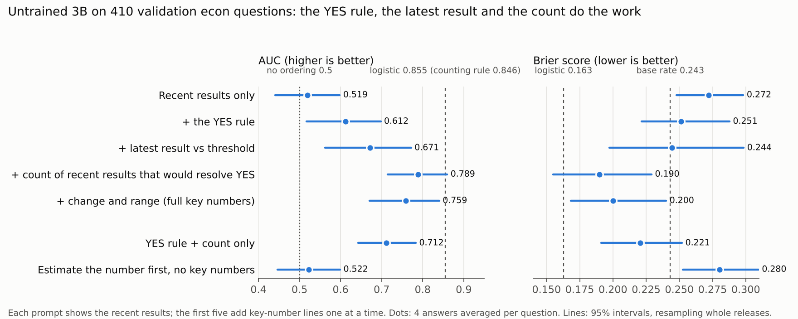

# Prompt ablation: which part of the key numbers does the work?

The untrained 3B model, with no training, scored on the 410 validation econ questions under seven prompts. Each shows the series' recent results. The first five add the key-numbers block one line at a time; the last two test alternatives. Same model loading, sampling (4 answers at temperature 0.7, averaged) and seed as every training run. Notebook `notebooks/phase2b_prompt_ablation.ipynb`, repo commit 5e20686, about 64 minutes of generation.

**The two prompts already scored reproduce:** recent results only, Brier 0.272 / AUC 0.519 (run 1's untrained answers: 0.272 / 0.520); full key numbers, 0.200 / 0.759 (run 3's: 0.201 / 0.757). The forecasts correlate 1.00 and 0.98 with the earlier ones.

## Results

| Prompt | Brier (95% interval) | AUC (95% interval) | Calibration error | Readable answers |
| --- | --- | --- | --- | --- |
| Recent results only | 0.272 (0.248 to 0.298) | 0.519 (0.441 to 0.598) | 0.120 | 98% |
| + the YES rule | 0.251 (0.222 to 0.288) | 0.612 (0.517 to 0.698) | 0.102 | 98% |
| + latest result vs threshold | 0.244 (0.197 to 0.299) | 0.671 (0.562 to 0.772) | 0.121 | 98% |
| **+ count of recent results that would resolve YES** | **0.190** (0.155 to 0.229) | **0.789** (0.714 to 0.860) | **0.055** | 97% |
| + change and range (full key numbers) | 0.200 (0.169 to 0.240) | 0.759 (0.671 to 0.840) | 0.066 | 98% |
| YES rule + count only | 0.221 (0.191 to 0.252) | 0.712 (0.643 to 0.783) | 0.108 | 96% |
| Estimate the number first, no key numbers | 0.280 (0.253 to 0.310) | 0.522 (0.447 to 0.599) | 0.155 | 92% |
| *Logistic regression on key numbers* | *0.163* | *0.855* | *0.087* | |
| *Counting rule* | *0.168* | *0.846* | *0.121* | |
| *Base rate* | *0.243* | *0.577* | *0.042* | |

Intervals resample whole releases (4,000 draws), `analysis/prompt_ablation_scores.csv`. Paired differences (2,000 draws, `analysis/prompt_ablation_bootstrap.csv`):

| Comparison | Brier change | AUC change |
| --- | --- | --- |
| YES rule vs recent results only | **−0.021** (−0.038 to −0.002) | **+0.093** (+0.040 to +0.146) |
| + latest result vs recent results only | −0.028 (−0.067 to +0.011) | **+0.152** (+0.083 to +0.227) |
| + count vs recent results only | **−0.082** (−0.111 to −0.054) | **+0.270** (+0.216 to +0.329) |
| Full key numbers vs recent results only | **−0.072** (−0.095 to −0.047) | **+0.240** (+0.181 to +0.306) |
| + count (without change and range) vs full | −0.010 (−0.029 to +0.009) | +0.030 (−0.009 to +0.070) |
| YES rule + count only vs full | **+0.021** (+0.003 to +0.037) | **−0.048** (−0.094 to −0.002) |
| Estimate first vs recent results only | +0.008 (−0.016 to +0.033) | +0.003 (−0.076 to +0.084) |

Bold: interval excludes 0.

## What it shows

1. **Three lines do the work, and each adds something.** Stating the YES rule in plain words (+0.09 AUC), comparing the latest result with the threshold (+0.06 more), and counting how many recent results would have resolved YES (+0.12 more, the biggest single step) take AUC from 0.52 to 0.79 and Brier from 0.272 to 0.190, with no training.
2. **Restating the rule alone helps.** Kalshi's rules are written as long legal sentences ("If the seasonally adjusted Consumer Price Index … increases by more than 0.5% …"). Restating the condition as "resolves YES if the result is above 0.5%" raises AUC by 0.09 with nothing else added, so part of the failure is parsing the question itself.
3. **The change and the range add nothing.** The full block is, if anything, slightly worse than stopping after the count (AUC −0.030, interval includes 0). The best untrained prompt is the three-line version: Brier 0.190, calibration error 0.055.
4. **The count needs the latest result next to it.** The YES rule plus the count alone, without the latest-result line, scores clearly worse than the full block (AUC −0.048, −0.094 to −0.002).
5. **Asking the model to estimate the number first does not help.** Without the key numbers, "estimate the value, then compare it with the threshold" scores the same as the plain prompt (AUC 0.522 vs 0.519), and 8% of answers lose the probability line. In the sampled answers the model does produce an estimate, sometimes a sensible one ("around 0.25%" against a 1.1% threshold) and sometimes one that misreads the recent trend (a Fed-rate estimate of 4.75% when the last results were 3.75% to 4.0%). The bottleneck is reading and comparing the numbers, not the order of the reasoning.
6. **The gains are broad.** Per-series AUC rises from the plain prompt to the three-line prompt in every threshold series, from 0.45 to 0.73 for CPI year-over-year up to 0.54 to 0.96 for unemployment. Payrolls, the noisiest series, stays lowest (0.35 to 0.49). Fed decisions, which have no key numbers, do not change (`analysis/prompt_ablation_per_series_auc.csv`, 3 to 5 releases per series).

## What it means for the paper

- The elicitation result is now specific: the model fails at three concrete steps (parsing the condition, comparing the latest value with the threshold, aggregating the recent history), and handing it each step recovers most of the gap to a logistic regression on the same evidence (Brier 0.190 vs 0.163).
- The RL runs trained on the full block, which is within noise of the best prompt, so their conclusions stand. Training on the three-line prompt is an obvious follow-up that we did not run.
- Scope: untrained model, validation econ questions, one sampling seed.
