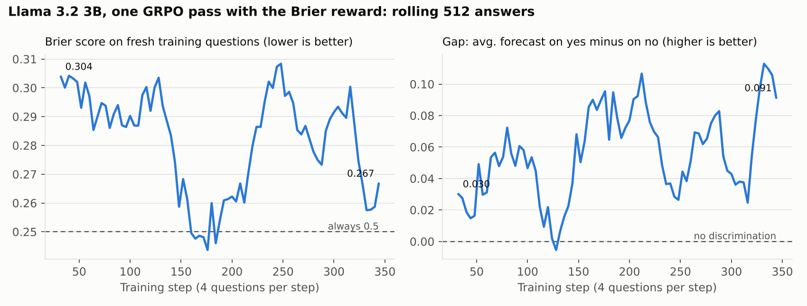

# RL run 1: 3B, Brier reward, one pass, learning rate 1e-5

Llama 3.2 3B Instruct, LoRA rank 32, GRPO with 4 answers per question, 4 questions per step, 347 steps (one pass over the 1,391 training questions, 104 minutes on a Kaggle T4). Rewards: Brier plus format. Context on. Notebook `phase3_grpo_train.ipynb`, repo commit db24b47, run name `3b_brier_ctx_lr1e-5`. Evaluated on the same questions, prompts and sampling as the Phase 2 baselines (4 answers at temperature 0.7, averaged).

## Result in one line

RL fixed the output format and **lowered the model's forecasts across the board**, which significantly improved its score on held-out weather questions. But a plain downward shift of the untrained model's forecasts does even better there, and **it did not get measurably better at telling yes from no** on 2026 economic questions.

## Untrained vs trained, with 95% intervals

Intervals come from a paired bootstrap that resamples whole events (a weather day, or one release's ladder of thresholds), 4,000 draws. Questions in the same event move together, so resampling single questions would make the intervals too narrow. "AUC" is the chance that a random question that resolved yes got a higher forecast than a random one that resolved no (0.5 = no discrimination).

| Eval set | Metric | Untrained | Trained | Change | 95% interval |
| --- | --- | --- | --- | --- | --- |
| Held-out weather (60 days, 360 questions) | Brier | 0.286 | 0.254 | **−0.032** | −0.056 to −0.009 |
| | Calibration error (ECE) | 0.355 | 0.289 | **−0.066** | −0.090 to −0.034 |
| | AUC | 0.532 | 0.466 | −0.066 | −0.164 to +0.035 |
| | Average forecast (yes-rate 0.167) | 0.518 | 0.449 | −0.069 | −0.095 to −0.044 |
| Validation econ (36 releases, 410 questions) | Brier | 0.272 | 0.267 | −0.005 | −0.024 to +0.016 |
| | AUC | 0.520 | 0.544 | +0.024 | −0.023 to +0.073 |
| | Gap (yes minus no) | 0.016 | 0.029 | +0.013 | −0.022 to +0.046 |
| | Average forecast (yes-rate 0.461) | 0.522 | 0.462 | −0.060 | −0.088 to −0.034 |

Other changes: readable answers 97.6% → 100%; median answer length 116 → 89 tokens; ladder violations unchanged (0.48); weather bracket sums 2.11 → 1.69 away from 1.

## How to read it

- **The weather gain is a shift, not weather skill.** Every forecast moved down by about 0.06–0.07 on both eval sets. Weather brackets resolve yes only 1 time in 6, so lower forecasts score better there. Shifting the *untrained* model's weather forecasts down by the same average amount gives a Brier score of **0.242**, better than the trained model's 0.254, and weather AUC did not improve. Logged as entry 2 in `writeup/hacks.md`.
- **Discrimination on new economic questions: no significant change.** AUC and the yes-minus-no gap moved in the right direction (84% and 78% of bootstrap draws), but both intervals include zero. With 36 releases, an effect this size can't be told apart from noise.
- **On fresh training questions, the model did improve during the run** (figure below: Brier 0.304 → 0.267, gap 0.03 → 0.09, rolling 512 answers). In a single pass each question is new when the model sees it, but these questions come from 2024–25. That the gain didn't carry over to 2026 suggests the model learned patterns specific to that period, or the in-run trend is noise. The windows swing a lot.
- Per series (point estimates only; 3–5 releases each): better on core CPI year over year (−0.028), Fed (−0.014), unemployment (−0.016); worse on payrolls (+0.038) and headline CPI (+0.011).

## What this means for the next runs

1. **Run 2: more training** (2 passes, learning rate 2e-5). Done: see `rl_run2_run3.md`. The ordering improved but the model became overconfident.
2. **The likely bottleneck is reading the context, not the optimizer.** The evidence is in the prompt: a one-line rule, "the share of the recent results that would have resolved YES under this question's threshold" (`recent_hits`), scores **Brier 0.168 and AUC 0.85** on the validation econ questions, against 0.272 and 0.52 for the untrained model and 0.267 and 0.54 after run 1. To use that evidence, the model has to compare the threshold with each recent value, which a 3B model does poorly from raw text. **Run 3** (`KEY_NUMBERS = True`, done: see `rl_run2_run3.md`) spells the comparison out in the prompt and otherwise repeats run 1, scoring the untrained model on the same prompt. It separates "the prompt alone helps" from "RL learned to use it", and `recent_hits` sets the bar: a model that only copies the count would match it, so beating it means combining the count with something else. (On weather, `recent_hits` is useless, AUC 0.43: last week's highs say little about which 2° bracket tomorrow lands in.)
3. Report **AUC and a shift-matched baseline** alongside Brier from now on, so a uniform shift can't pass for skill.
