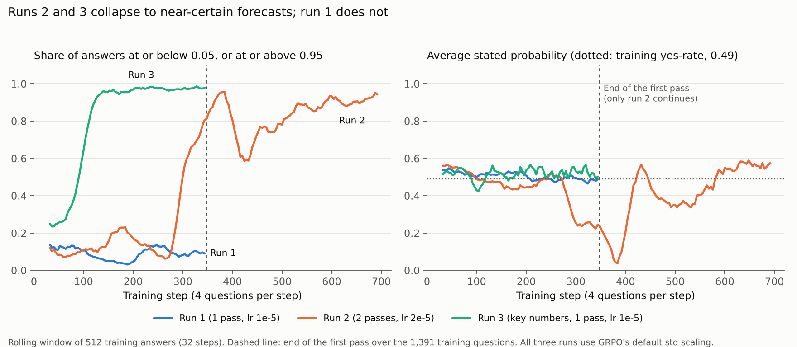

# RL runs 2 and 3: overconfidence, and collapse onto a lookup rule

Both runs use Llama 3.2 3B Instruct, LoRA rank 32, GRPO with 4 answers per question and 4 questions per step, a Brier plus format reward, and TRL's default reward scaling (each answer's advantage divided by the standard deviation of rewards in its group, `scale_rewards="group"`). Evaluation is the same as in run 1: 410 validation econ questions (36 releases) and 360 held-out weather questions (60 days), 4 answers at temperature 0.7, averaged.

| Run | Prompt | Training | Repo commit | Training time |
| --- | --- | --- | --- | --- |
| 1 (for reference) | Recent results | 1 pass (347 steps), learning rate 1e-5 | db24b47 | 104 min |
| 2 `3b_brier_ctx_lr2e-5_2ep` | Recent results | 2 passes (694 steps), learning rate 2e-5 | db24b47 | 160 min |
| 3 `3b_brier_keynum_lr1e-5` | Recent results + key numbers | 1 pass (347 steps), learning rate 1e-5 | 1751fac | 80 min |

The **key numbers** block (`env/features.py`) spells out what the question's threshold implies given the recent results already in the prompt: the latest result and its distance from the threshold, the change from the result before, how many recent results would have resolved YES, and their average and range. It adds no new information.

## Results in brief

1. **Spelling out the evidence works without any training.** On the validation econ questions, the key-numbers prompt raises the untrained model's AUC from 0.52 to 0.76 (+0.24, 95% interval +0.18 to +0.30) and lowers its Brier score from 0.272 to 0.201. It is the first model setting that beats the base rate (0.243).
2. **More training (run 2) learned some real ordering, but made the model overconfident.** AUC rose from 0.52 to 0.69 (+0.17, +0.10 to +0.25). But 72% of forecasts ended up at or below 0.05 or at or above 0.95, calibration error rose from 0.12 to 0.30, and the Brier score got worse (0.320). Once its forecasts are recalibrated, it does beat the untrained model (0.238 vs 0.259).
3. **RL on top of the key numbers (run 3) collapsed onto a lookup rule.** Within about 100 steps most of its forecasts were at 0 or 1, and by about step 240 it had stopped reasoning (its eval answers have a median of 7 tokens, against 109 untrained). It answers exactly 0.00 or 1.00 according to one cue: "has the latest result already crossed the threshold?" It agrees with that rule on 99.9% of threshold questions. AUC was unchanged (0.757 to 0.771, interval −0.05 to +0.07), and calibration got much worse.
4. **The collapse is not what the reward asks for.** On the training questions themselves, the same rule stated at its actual hit rates (84% / 15%) earns a higher average Brier reward (0.870) than the 0/1 version the model converged to (0.847). Std-scaled GRPO drove the model away from the reward's own optimum. This is the mechanism [Bereket & Leskovec (2025)](https://arxiv.org/pdf/2508.11800) describe, seen here with a Brier reward on real forecasting questions.
5. **A one-line counting rule still beats every model.** "Share of recent results that would have resolved YES" scores Brier 0.168 and AUC 0.85 on the validation econ questions.
6. **Weather: nothing has any discrimination.** Every method's weather Brier score, once recalibrated, is the base rate's (about 0.139). The Brier gains there come from lowering the average forecast.

## Validation econ: every method on the same 410 questions

| Method | Brier | Log loss | Calibration error (ECE) | AUC | Average forecast | Share at ≤0.05 or ≥0.95 |
| --- | --- | --- | --- | --- | --- | --- |
| Market price | 0.062 | 0.200 | 0.023 | 0.977 | 0.460 | 59% |
| Counting rule | **0.168** | **0.573** | 0.121 | **0.846** | 0.476 | 53% |
| Untrained, key numbers | 0.201 | 0.594 | **0.060** | 0.757 | 0.482 | 6% |
| Latest-result rule (0/1) | 0.218 | 1.003 | 0.212 | 0.775 | 0.424 | 96% |
| Run 3 (key numbers, trained) | 0.223 | 1.030 | 0.224 | 0.771 | 0.422 | 99% |
| Base rate | 0.243 | 0.679 | 0.042 | 0.577 | 0.495 | 0% |
| Run 1 | 0.267 | 0.734 | 0.123 | 0.544 | 0.462 | <1% |
| Untrained, plain prompt | 0.272 | 0.748 | 0.120 | 0.520 | 0.522 | 1% |
| Run 2 | 0.320 | 1.287 | 0.298 | 0.686 | 0.344 | 72% |

Yes-rate 0.461. The market is a benchmark only; the model never sees prices. Bold marks the best non-market value.

## Paired comparisons with 95% intervals

Event-level bootstrap (4,000 draws, resampling whole releases or weather days), `eval/analysis/runs23_paired_bootstrap.csv`. Change is second minus first.

| Comparison | Eval set | Brier change | AUC change | ECE change |
| --- | --- | --- | --- | --- |
| Key numbers vs plain prompt (both untrained) | Econ | **−0.071** (−0.095 to −0.044) | **+0.237** (+0.177 to +0.303) | −0.060 (−0.098 to +0.014) |
| | Weather | **−0.063** (−0.086 to −0.039) | **−0.090** (−0.174 to −0.006) | **−0.142** (−0.173 to −0.107) |
| Run 2 vs untrained (plain prompt) | Econ | +0.048 (−0.024 to +0.121) | **+0.166** (+0.100 to +0.245) | **+0.178** (+0.064 to +0.255) |
| | Weather | **−0.070** (−0.094 to −0.046) | +0.001 (−0.087 to +0.090) | **−0.138** (−0.171 to −0.101) |
| Run 3 vs untrained (key numbers) | Econ | +0.022 (−0.043 to +0.098) | +0.014 (−0.048 to +0.074) | **+0.164** (+0.032 to +0.224) |
| | Weather | **+0.075** (+0.052 to +0.096) | +0.016 (−0.047 to +0.074) | **+0.087** (+0.053 to +0.116) |
| Run 3 vs latest-result rule | Econ | +0.005 (0.000 to +0.013) | −0.003 (−0.011 to 0.000) | +0.012 (0.000 to +0.029) |
| Counting rule vs untrained (key numbers) | Econ | −0.034 (−0.068 to +0.005) | **+0.089** (+0.016 to +0.164) | +0.061 (−0.021 to +0.094) |

Bold: interval excludes 0. On weather, the key numbers *hurt* ordering (AUC −0.09) while lowering the average forecast by 0.21. The Brier gain there is a level shift toward the base rate, not skill.

## What run 3 learned

- 98.9% of its forecasts on threshold questions are at or below 0.02 or at or above 0.98. Of its 3,080 eval answers, 2,117 say exactly 0.00 and 931 say exactly 1.00.
- It sits on the same side of 0.5 as the latest-result rule on 99.9% of the 755 threshold questions, and its forecasts are on average 0.003 away from the rule's 0 or 1.
- On 98.7% of questions, all 4 sampled answers are identical, at temperature 0.7.
- Per series, its Brier scores match the rule's to within 0.0001 (Fed 0.000, unemployment 0.060, core CPI 0.095, payrolls 0.541). The rule is right for slow-moving series and badly wrong for payrolls.
- Like the rule, it has zero ladder violations, and its weather brackets sum to 1. Better consistency here comes from a hard rule, not from better forecasting.

Run 2 drifted toward the same rule from the raw context: it is on the rule's side for 79.5% of threshold questions, against 58.5% for the untrained model and 64.3% for run 1.

## Is the collapse what the reward asks for?

No. On the 1,283 training questions that have a numeric threshold, the latest-result rule is right 84.6% of the time. When it says yes, 84.0% resolve yes; when it says no, 14.6% do. Stating the rule at those rates earns an average Brier reward of **0.870**. Stating it as 0 or 1, what run 3 converged to, earns **0.847**. Since the Brier score is a proper scoring rule, the calibrated version is better in expectation on the very questions being trained on. The training dynamics went somewhere the reward does not prefer.

## Recalibration test

Platt scaling (a logistic fit on each method's log-odds), fitted out-of-fold with whole releases held out (6 folds), `eval/analysis/runs23_recalibration.csv`. It asks: if we fix calibration after the fact, how good is the ordering underneath?

| Method (econ) | Brier as stated | Brier after recalibration | AUC |
| --- | --- | --- | --- |
| Counting rule | 0.168 | 0.168 | 0.846 |
| Run 3 | 0.223 | 0.184 | 0.771 |
| Latest-result rule | 0.218 | 0.184 | 0.775 |
| Untrained, key numbers | 0.201 | 0.215 | 0.757 |
| Run 2 | 0.320 | 0.238 | 0.686 |
| Run 1 | 0.267 | 0.253 | 0.544 |
| Untrained, plain prompt | 0.272 | 0.259 | 0.520 |

The untrained key-numbers model gets slightly worse after recalibration: it was already calibrated (ECE 0.06), and refitting on 5/6 of 36 releases adds noise. On weather, every method lands at 0.138 to 0.140 after recalibration, the base rate's score.

## Training dynamics

- **Run 1** never collapsed: 3% to 14% of answers were near-certain throughout.
- **Run 3** collapsed fastest. The share of near-certain answers passed 50% by step 92 and stayed at 95% to 99% from about step 190.
- **Run 2** collapsed inside its *first* pass. The share passed 50% around step 300. The average forecast then swung to 0.04 at step 384 (almost every answer "no") before recovering to a two-sided 0/1 pattern (94% near-certain at the end).

So the collapse does not need a second pass. It appears once the model has a cue it can follow (the key numbers) or enough optimization to find one in the raw text (run 2).

## What this means for the next runs

1. **Run 4: run 3's settings with `scale_rewards="none"`** (subtract the group mean only). If std scaling drives the collapse, run 4 should keep forecasts away from 0 and 1 and keep the key-numbers model's calibration. That would be the first test of the Bereket & Leskovec mechanism with a Brier reward on real forecasting questions.
2. If run 4 still collapses, try a KL penalty toward the untrained model (`beta` > 0). Separately, a shuffled-outcome control shows what RL changes when the reward carries no signal.
3. **Main comparison for the paper:** untrained with key numbers (0.201) and the counting rule (0.168) are the bars to beat. A trained model is only interesting if it beats both, or matches the counting rule while staying calibrated.
4. **Metrics:** AUC is the discrimination measure. The yes-minus-no gap rose from 0.22 to 0.54 in run 3 with no AUC change, so it measures sharpening, not ordering.
