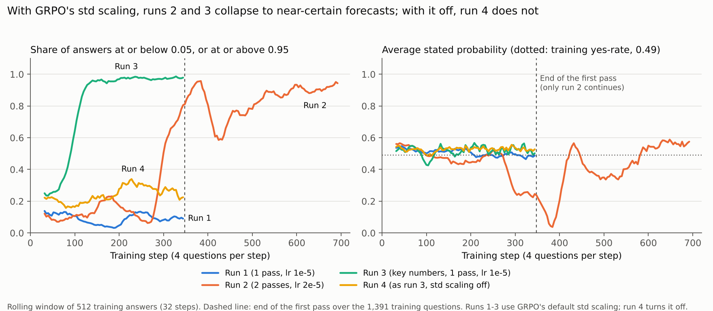

# RL run 4: the same as run 3, with GRPO's std scaling turned off

Run 4 repeats run 3 exactly (Llama 3.2 3B Instruct, LoRA rank 32, key numbers in the prompt, Brier plus format reward, one pass of 347 steps at learning rate 1e-5, 4 answers per question) and changes one setting: `scale_rewards="none"`. Each answer's advantage is its reward minus the average reward in its group of 4, without dividing by the group's standard deviation. Run name `3b_brier_keynum_lr1e-5_nostd`, repo commit d602417, 107 minutes of training. The untrained answers in this run are identical to run 3's (same prompt, same sampling seed), so all comparisons are paired on the same 770 questions.

**One training seed so far.** Everything below needs repeating with more seeds before it goes in the paper.

## Results in brief

1. **No collapse.** On the validation econ questions, 16% of run 4's forecasts are at or below 0.05 or at or above 0.95 (run 3: 99%). Its 4 sampled answers are identical on 4% of questions (run 3: 99%), and its answers keep their reasoning (median 72 tokens; run 3: 7). During training, the share of near-certain answers stayed between 16% and 34% (figure below).
2. **RL improved on the untrained model, in ordering, without losing calibration.** Brier 0.201 → 0.169 (−0.033, 95% interval −0.056 to −0.008), AUC 0.757 → 0.828 (+0.071, +0.028 to +0.119), log loss 0.594 → 0.519 (−0.075, −0.139 to −0.004), calibration error unchanged (0.060 → 0.063). The average forecast barely moved (−0.011, interval includes 0), and the untrained model shifted to the same average scores 0.201, so this is not run 1's level shift.
3. **Std scaling is the difference between collapse and improvement.** Against run 3, which differs only in that setting: Brier −0.054 (−0.114 to −0.005), AUC +0.057 (+0.017 to +0.102), calibration error −0.162 (−0.199 to −0.039), log loss −0.51 (−0.86 to −0.22).
4. **Against the simple rules, the differences are not resolved.** Against the counting rule: Brier +0.001 (−0.030 to +0.034), AUC −0.018 (−0.075 to +0.032). Against the logistic regression on the key numbers: Brier +0.006 (−0.032 to +0.035), AUC −0.027 (−0.063 to +0.009). Its forecasts correlate 0.91 with the logistic regression's. It is better calibrated than the counting rule (0.063 vs 0.121), though that interval includes 0.
5. **It learned more than the lookup rule run 3 collapsed onto.** Against the latest-result rule, AUC +0.054 (+0.010 to +0.101). Among questions where that rule says yes, run 4 orders outcomes with AUC 0.61 (untrained: 0.47); where it says no, 0.71 (untrained: 0.67). The model is using the other key numbers, not just the latest result.
6. **No transfer to weather.** Weather Brier 0.223, the same as the untrained model (change 0.000, −0.014 to +0.014), AUC 0.44. Recalibrated, it scores the base rate's 0.139, as every method does.

## Validation econ: every method on the same 410 questions

| Method | Brier | Log loss | Calibration error (ECE) | AUC | Average forecast | Share at ≤0.05 or ≥0.95 |
| --- | --- | --- | --- | --- | --- | --- |
| Market price | 0.062 | 0.200 | 0.023 | 0.977 | 0.460 | 59% |
| Logistic regression on key numbers | **0.163** | 0.522 | 0.087 | **0.855** | 0.418 | 36% |
| Counting rule | 0.168 | 0.573 | 0.121 | 0.846 | 0.476 | 53% |
| **Run 4 (std scaling off)** | 0.169 | **0.519** | 0.063 | 0.828 | 0.472 | 16% |
| Untrained, key numbers | 0.201 | 0.594 | **0.060** | 0.757 | 0.482 | 6% |
| Latest-result rule (0/1) | 0.218 | 1.003 | 0.212 | 0.775 | 0.424 | 96% |
| Run 3 (std scaling on) | 0.223 | 1.030 | 0.224 | 0.771 | 0.422 | 99% |
| Base rate | 0.243 | 0.679 | 0.042 | 0.577 | 0.495 | 0% |
| Untrained, plain prompt | 0.272 | 0.748 | 0.120 | 0.520 | 0.522 | 1% |

Yes-rate 0.461. Bold marks the best non-market value. Full tables: `analysis/run4_scores.csv`, `analysis/run4_paired_bootstrap.csv`.

## Paired comparisons with 95% intervals

Event-level bootstrap, 4,000 draws (whole releases or weather days resampled). Change is run 4 minus the other method.

| Run 4 vs | Eval set | Brier change | AUC change | ECE change |
| --- | --- | --- | --- | --- |
| Untrained, key numbers | Econ | **−0.033** (−0.056 to −0.008) | **+0.071** (+0.028 to +0.119) | +0.003 (−0.036 to +0.044) |
| | Weather | 0.000 (−0.014 to +0.014) | −0.005 (−0.061 to +0.049) | −0.005 (−0.036 to +0.034) |
| Run 3 (std scaling on) | Econ | **−0.054** (−0.114 to −0.005) | **+0.057** (+0.017 to +0.102) | **−0.162** (−0.199 to −0.039) |
| | Weather | **−0.075** (−0.092 to −0.058) | −0.021 (−0.081 to +0.042) | **−0.092** (−0.113 to −0.059) |
| Counting rule | Econ | +0.001 (−0.030 to +0.034) | −0.018 (−0.075 to +0.032) | −0.058 (−0.098 to +0.027) |
| Logistic regression | Econ | +0.006 (−0.032 to +0.035) | −0.027 (−0.063 to +0.009) | −0.024 (−0.073 to +0.057) |
| Latest-result rule | Econ | −0.049 (−0.109 to +0.001) | **+0.054** (+0.010 to +0.101) | **−0.150** (−0.188 to −0.024) |
| Untrained, plain prompt | Econ | **−0.103** (−0.142 to −0.062) | **+0.309** (+0.240 to +0.381) | −0.058 (−0.097 to +0.011) |

Bold: interval excludes 0.

## Per series (validation econ, Brier, point estimates)

Each series has only 3 to 5 releases here, so these are descriptive, not tests.

| Series | Releases | Untrained, key numbers | Run 3 | Run 4 | Logistic | Counting rule |
| --- | --- | --- | --- | --- | --- | --- |
| Core CPI (month) | 5 | 0.146 | 0.095 | 0.088 | 0.071 | 0.057 |
| Core CPI (year) | 5 | 0.201 | 0.145 | 0.134 | 0.115 | 0.166 |
| CPI (year) | 5 | 0.218 | 0.227 | 0.184 | 0.176 | 0.251 |
| Fed funds rate | 3 | 0.146 | 0.000 | 0.065 | 0.032 | 0.104 |
| Unemployment | 5 | 0.134 | 0.060 | 0.077 | 0.049 | 0.048 |
| CPI (month) | 5 | 0.167 | 0.267 | 0.198 | 0.209 | 0.211 |
| Payrolls | 5 | 0.273 | 0.540 | 0.291 | 0.359 | 0.232 |
| Fed decision (hike/cut/hold; no key numbers) | 3 | 0.368 | 0.299 | 0.342 | 0.160 | 0.160 |

Run 4 improves on five of the seven threshold series and loses some ground on headline CPI and payrolls, the two noisiest. On payrolls it avoids run 3's disaster (0.291 vs 0.540).

## Training dynamics

Runs 3 and 4 start from the same point. With std scaling, run 3's share of near-certain answers passes 50% by step 92; without it, run 4's stays between 16% and 34% for the whole pass.

## What this means

- **The paper's main result, if it holds across seeds:** making the evidence legible and removing GRPO's std scaling lets RL improve a 3B model's ordering on new questions (AUC +0.07) while keeping it calibrated, reaching the level of a logistic regression on the same evidence. With std scaling, the same run collapses onto a lookup rule. This is the Bereket & Leskovec (2025) mechanism with a Brier reward, on real forecasting questions, plus the observation that the collapse lowers the expected reward on the training questions themselves (`rl_run2_run3.md`).
- **What it is not:** the model does not beat simple statistical rules on the same evidence, and it learned nothing that transfers to weather.

## Next runs

1. **Seeds:** two more runs of this setup (`TRAIN_SEED` 1 and 2), plus two more of run 3's setup, to show the collapse and the improvement both replicate.
2. **Complete the 2 × 2:** plain prompt with std scaling off (run 1's setup with `SCALE_REWARDS = "none"`). Can RL without std scaling learn to read the raw context without the key numbers?
3. **Shuffled-outcome control** (run 4's setup with `SHUFFLE_OUTCOMES = True`): what RL changes when the reward carries no signal.
4. Then the log-score reward and the 1B model, if time allows. The test split stays untouched until the final settings are fixed.
