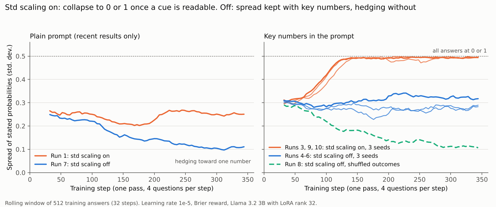

# Runs 5 to 7: three seeds of the main setup, and the full 2 × 2

Runs 5 and 6 repeat run 4 (key numbers, GRPO std scaling off) with training seeds 1 and 2. Run 7 is run 1 (plain prompt) with std scaling off, which completes the 2 × 2 of prompt × std scaling. All runs: Llama 3.2 3B Instruct, LoRA rank 32, Brier plus format reward, one pass of 347 steps at learning rate 1e-5, 4 answers per question; repo commit 0f576a3 (runs 5 to 7). Evaluation as before: 410 validation econ questions (36 releases), 360 held-out weather questions (60 days), 4 answers at temperature 0.7 averaged, with the eval days and sampling seed held fixed across runs.

## Results in brief

1. **The main result replicates across three seeds.** Averaged over runs 4 to 6, against the untrained model with the same prompt: Brier **−0.031** (95% interval −0.049 to −0.013), AUC **+0.070** (+0.029 to +0.115), log loss −0.072 (−0.118 to −0.024), calibration error unchanged (+0.008, −0.027 to +0.038). The seeds barely differ: Brier 0.169 to 0.171 (standard deviation 0.0014), AUC 0.820 to 0.832 (0.0064). Each seed's interval alone also excludes zero for Brier and AUC.
2. **The seeds tie the logistic regression on the same evidence:** Brier +0.008 (−0.035 to +0.041), AUC −0.028 (−0.061 to +0.006).
3. **Without the key numbers, unbiased RL learns nothing useful (run 7).** Against the untrained plain-prompt model: Brier −0.009 (−0.026 to +0.007), AUC −0.035 (−0.092 to +0.019). Its forecasts squeezed toward one number: the spread fell from 0.166 to 0.061, and every validation forecast lies between 0.36 and 0.71. This is the proper-scoring-rule optimum for a model that is not using its evidence. It still scores worse than simply stating the base rate (0.263 vs 0.243).
4. **No transfer to weather.** Averaged over the three seeds, weather Brier changes by −0.007 (−0.019 to +0.006), and AUC stays at about 0.43.

## The 2 × 2 on the validation econ questions

| | GRPO std scaling on | GRPO std scaling off |
| --- | --- | --- |
| **Plain prompt** (untrained: Brier 0.272, AUC 0.520) | Run 1: 0.267 / 0.544. Forecasts shift down 0.06; ordering unchanged | Run 7: 0.263 / 0.485. Forecasts squeeze toward 0.56; ordering unchanged |
| **Key numbers** (untrained: 0.201 / 0.757) | Run 3: 0.223 / 0.771. Collapse onto the latest-result rule, all answers 0 or 1 | **Runs 4 to 6: 0.170 / 0.827** (3 seeds). Better ordering, calibration kept |

Cells show Brier / AUC. Only the bottom-right cell improves on its untrained model in both.

The figure shows the same four outcomes during training (plus run 8, the shuffled-outcome control, dashed). With std scaling, run 3's spread rises to 0.5, every answer at 0 or 1. Without it, runs 4 to 6 keep a spread near 0.3 when the evidence is readable, and run 7 hedges (spread 0.25 to 0.11) when it is not.

## Validation econ: every method on the same 410 questions

| Method | Brier | Log loss | Calibration error | AUC | Average forecast | Spread (std. dev.) |
| --- | --- | --- | --- | --- | --- | --- |
| Market price | 0.062 | 0.200 | 0.023 | 0.977 | 0.460 | 0.417 |
| Logistic regression on key numbers | 0.163 | 0.522 | 0.087 | 0.855 | 0.418 | 0.375 |
| Counting rule | 0.168 | 0.573 | 0.121 | 0.846 | 0.476 | 0.403 |
| Run 4 (seed 3407) | 0.169 | 0.519 | 0.063 | 0.828 | 0.472 | 0.319 |
| Run 5 (seed 1) | 0.171 | 0.521 | 0.054 | 0.820 | 0.497 | 0.287 |
| Run 6 (seed 2) | 0.171 | 0.527 | 0.088 | 0.832 | 0.532 | 0.269 |
| Untrained, key numbers | 0.201 | 0.594 | 0.060 | 0.757 | 0.482 | 0.244 |
| Latest-result rule (0/1) | 0.218 | 1.003 | 0.212 | 0.775 | 0.424 | 0.489 |
| Run 3 (key numbers, std on) | 0.223 | 1.030 | 0.224 | 0.771 | 0.422 | 0.493 |
| Base rate | 0.243 | 0.679 | 0.042 | 0.577 | 0.495 | 0.083 |
| Run 7 (plain, std off) | 0.263 | 0.720 | 0.107 | 0.485 | 0.564 | 0.061 |
| Run 1 (plain, std on) | 0.267 | 0.734 | 0.123 | 0.544 | 0.462 | 0.181 |
| Untrained, plain prompt | 0.272 | 0.748 | 0.120 | 0.520 | 0.522 | 0.166 |

Yes-rate 0.461. Full tables: `analysis/runs1to7_scores.csv`, `analysis/runs1to7_paired_bootstrap.csv`, `analysis/runs4to6_seed_average.csv`.

## Paired comparisons (validation econ, 95% intervals)

Event-level bootstrap, 4,000 draws. For the three-seed rows, each draw averages the three seeds' differences on the same resampled releases, so the interval covers question sampling but not seed variation (the seeds' own spread is reported separately above).

| Comparison | Brier change | AUC change | Calibration error change |
| --- | --- | --- | --- |
| Runs 4 to 6 vs untrained (key numbers) | **−0.031** (−0.049 to −0.013) | **+0.070** (+0.029 to +0.115) | +0.008 (−0.027 to +0.038) |
| Run 4 vs untrained (key numbers) | **−0.033** (−0.056 to −0.008) | **+0.071** (+0.028 to +0.119) | +0.003 (−0.036 to +0.044) |
| Run 5 vs untrained (key numbers) | **−0.030** (−0.049 to −0.010) | **+0.063** (+0.020 to +0.109) | −0.007 (−0.038 to +0.032) |
| Run 6 vs untrained (key numbers) | **−0.030** (−0.046 to −0.016) | **+0.075** (+0.038 to +0.117) | +0.028 (−0.039 to +0.067) |
| Runs 4 to 6 vs run 3 (std on) | −0.053 (−0.116 to +0.002) | **+0.056** (+0.022 to +0.095) | **−0.156** (−0.216 to −0.016) |
| Runs 4 to 6 vs logistic regression | +0.008 (−0.035 to +0.041) | −0.028 (−0.061 to +0.006) | −0.019 (−0.084 to +0.078) |
| Run 7 vs untrained (plain) | −0.009 (−0.026 to +0.007) | −0.035 (−0.092 to +0.019) | −0.013 (−0.081 to +0.040) |
| Run 7 vs run 1 | −0.004 (−0.034 to +0.020) | −0.059 (−0.129 to +0.003) | −0.016 (−0.117 to +0.069) |

Bold: interval excludes 0.

## Per series (validation econ, Brier, point estimates)

3 to 5 releases per series, so these are descriptive.

| Series | Untrained, key numbers | Run 4 | Run 5 | Run 6 | Logistic | Run 7 (plain) |
| --- | --- | --- | --- | --- | --- | --- |
| Core CPI (month) | 0.146 | 0.088 | 0.077 | 0.077 | 0.071 | 0.229 |
| Core CPI (year) | 0.201 | 0.134 | 0.153 | 0.175 | 0.115 | 0.282 |
| CPI (year) | 0.218 | 0.184 | 0.185 | 0.178 | 0.176 | 0.266 |
| Fed funds rate | 0.146 | 0.065 | 0.071 | 0.091 | 0.032 | 0.277 |
| Unemployment | 0.134 | 0.077 | 0.093 | 0.110 | 0.049 | 0.261 |
| CPI (month) | 0.167 | 0.198 | 0.162 | 0.156 | 0.209 | 0.247 |
| Payrolls | 0.273 | 0.291 | 0.300 | 0.269 | 0.359 | 0.252 |
| Fed decision (no key numbers) | 0.368 | 0.342 | 0.335 | 0.330 | 0.160 | 0.325 |

All three seeds improve on the untrained model for core CPI (both), CPI year-over-year, the Fed funds rate and unemployment. Payrolls, the noisiest series, does not improve in any seed.

## What this means

The paper's central claim now has every cell of the 2 × 2 and three seeds behind it: **RL with a Brier reward improved this 3B model's forecasts only when the evidence was legible and GRPO's advantages were not divided by the group's standard deviation.** With legible evidence and std scaling, it collapsed onto a lookup rule. Without legible evidence, it shifted (std scaling on) or hedged (off). The improved model reaches, but does not pass, a logistic regression on the same evidence.

The shuffled-outcome control (run 8, `rl_run8.md`) shows the gain comes from the outcomes: with them shuffled, the same setup gets worse (Brier +0.035) and hedges like run 7. Since then: the prompt ablation (`prompt_ablation.md`) and two more seeds of run 3's collapse (runs 9 and 10, `rl_runs9_10.md`), which replicate it. Remaining: one evaluation on the untouched test split (`test_plan.md`).
